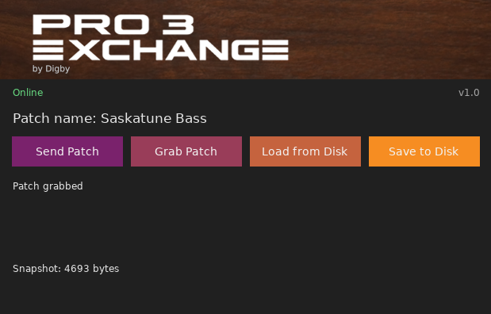

# Pro 3 Exchange

**Pro 3 Exchange v1.0** is an independent REAPER JSFX utility by Digby (Roman Altenburg) for capturing and managing Sequential Pro 3 edit-buffer patches.

Writing down all the settings you used for a patch to create the sound you wanted is a bit clumsy and, if you forget a setting, won’t give you the same sound. Multiply this problem by the number of patches you used in a session, and chances are you won’t recreate the sound you originally designed. You could save the patches, but then you still have to write down which track used which patch.

At least, that’s the problem I had, and it annoyed me to no end and wasted my time. To fix my workflow, I made a simple little helper script.

Pro 3 Exchange is a Linux-focused REAPER JSFX for capturing and managing Sequential Pro 3 patches. Grab the current patch to store it with your REAPER project, then send it back later to restore the sound.

The script also allows you to save a patch to disk as a .syx file and load a saved patch from disk.

Sending a patch does not write it to a saved slot on the Pro 3, but it does replace the active edit buffer. Save any unsaved patch edits before sending anything.

[GitHub: @digbys202](https://github.com/digbys202) · [romanaltenburg.me](https://romanaltenburg.me)

## Features

- Capture the current edit buffer into the REAPER project.
- Send a captured patch to the Pro 3 on request.
- Load and save individual `.syx` patches; whole patch-bank files are not supported.

A patch snapshot is stored with the REAPER project. Loading a `.syx` file does not send it automatically.

## Requirements

- REAPER with JSFX support.
- A Sequential Pro 3 connected as an ALSA MIDI device on Linux.
- The Linux ALSA utilities `aconnect` and `aplaymidi`, and `mktemp`, available at `/usr/bin`.

Hardware testing was performed with Pro 3 firmware 1.2.1; other firmware versions have not been verified.

The bundled helper currently uses Linux ALSA commands; other operating systems are not supported by this release.

## Installation

1. Copy the `Effects/Pro 3 Exchange` folder into REAPER's `Effects` folder. Keep the filenames unchanged.
2. Copy `Scripts/Exchange Helper.lua` into REAPER's `Scripts` folder.
3. In REAPER, open **Actions > Show action list**, choose **New action > Load ReaScript**, and select `Exchange Helper.lua` from the installed `Scripts` folder.
4. Start the helper manually, or configure it to start automatically with either the SWS **Project Startup Action** for selected projects or the SWS **Global Startup Action** for every REAPER launch. Choose one autostart method; do not register both or run a second helper instance.
5. Add a MIDI track routed to the Pro 3. The plugin needs incoming Pro 3 MIDI for edit-buffer replies, and an output route to send Grab requests.
6. Insert **Pro 3 Exchange** on that track.

The JSFX sends Grab requests through REAPER's track MIDI routing. In this setup, REAPER opening the Pro 3 port prevented a separate raw-MIDI program such as `amidi` from opening it at the same time; this does not prevent the JSFX from using REAPER's MIDI route.

The Exchange Helper is required for Send, Load from Disk, and Save to Disk: it handles the file dialogs and transfers patch data through the Pro 3's ALSA MIDI sequencer using `aplaymidi`. The Pro 3 must be visible to ALSA as client `Pro 3`, port `Pro 3 MIDI 1`.

The Exchange Helper is shared by all my Exchange plugins. Install it once and run only one instance, even if you use multiple Exchange plugins.

## Tests

The regression tests use synthetic MIDI and the [ysfx](https://github.com/jpcima/ysfx) library; they do not connect to hardware. See [`tests/README.md`](tests/README.md) for build and run instructions.

## Artwork

The header artwork is original work by Digby.

## AI-Assisted Development

Much of the code was developed with assistance from OpenAI ChatGPT, primarily GPT-6.1, then reviewed, adapted, integrated, and tested by Digby (Roman Altenburg). This acknowledges development assistance; copyright attribution remains as stated in `NOTICE`. OpenAI does not endorse this project.

## License and Trademarks

The software and original artwork in this repository are licensed under Apache-2.0; see [`LICENSE`](LICENSE) and [`NOTICE`](NOTICE).

REAPER, Sequential and Pro 3 are names or marks of their respective owners. Pro 3 Exchange is an independent community project and is not affiliated with, endorsed by, or sponsored by Cockos or Sequential.
